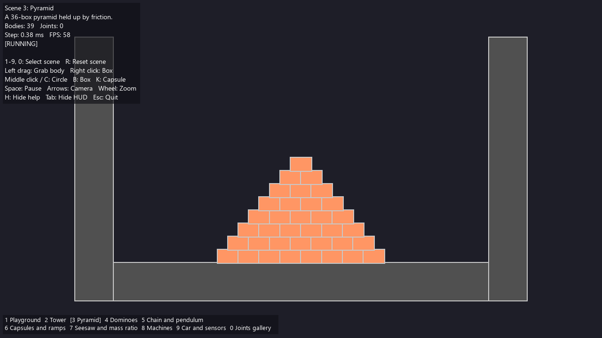
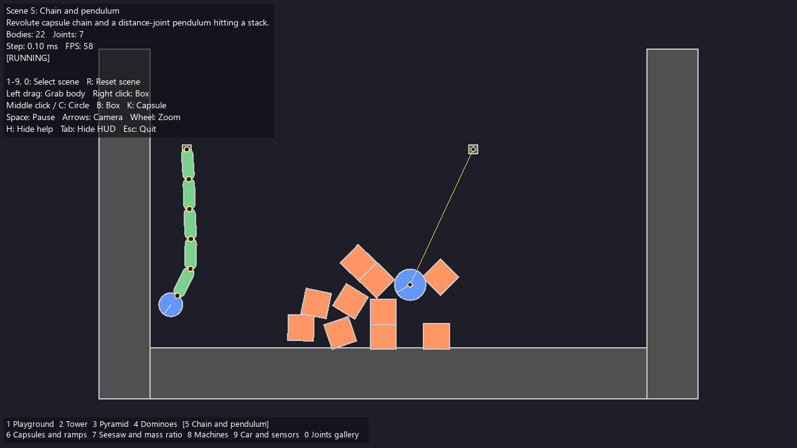
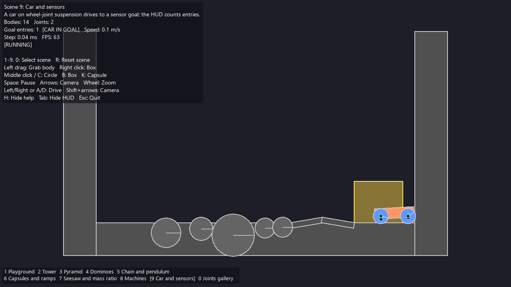
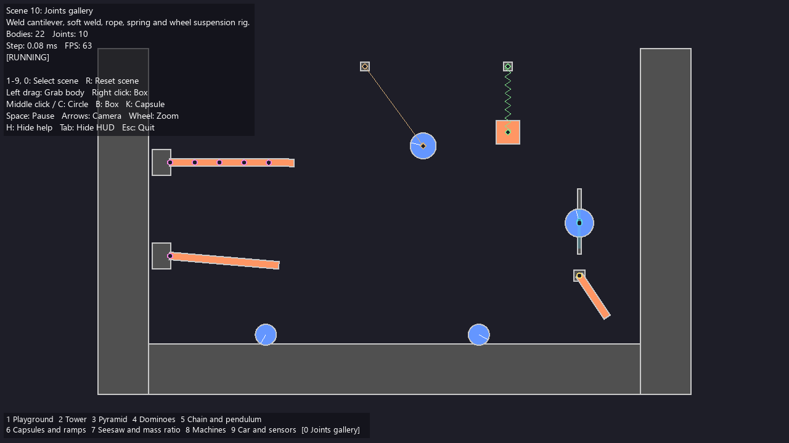

# 2D Physics Engine

A C++17 library for 2D physics, built natively and as WebAssembly. Its core is a
rigid-body engine with circles, convex polygons and capsules, contacts, joints,
sensors, sleeping and spatial queries. Beside it are SPH fluids, particles,
mass-spring soft bodies and standalone models for heat, gravity, waves, flow,
gas dynamics and electromagnetism. Use it to simulate game-style rigid bodies, or
to run small, documented numerical models that tests check against analytical
or independent references. It is released under the [MIT License](LICENSE).

The native library has no third-party runtime dependency beyond the C++ runtime.
Catch2 is vendored for the tests. The separate visualizer uses SFML.

| Pyramid | Chain and pendulum |
|---------|--------------------|
|  |  |
| **Car on wheel-joint suspension, sensor goal** | **Joints gallery** |
|  |  |

These are captures of scenes 3, 5, 9 and 10 of the native [SFML visualizer](visualization/README.md).

## Features

### Rigid bodies

- Shapes: circles, convex polygons and [capsules](docs/capsules.md). Bodies copy their shapes. ([getting started](docs/getting-started.md))
- Contacts: multi-point manifolds, speculative contacts, friction and restitution, and a
  [substepped soft contact solver](docs/contact-solver.md#substepped-soft-contacts). ([manifolds](docs/contact-manifolds.md))
- [Continuous collision detection](docs/collision-lifecycle-and-ccd.md) for translating circles. Polygon pairs and rotation are not swept.
- [Sensors and user data](docs/sensors.md): overlap events without contact forces, and an opaque value per body.
- [Collision filtering](docs/collision-filtering.md) with a category and mask per body.
- Joints: [distance (spring and length range), revolute (motor and limits), prismatic](docs/joints-and-sleeping.md), [mouse, weld and wheel](docs/joints-mouse-weld-wheel.md).
- [Islands and optional sleeping](docs/joints-and-sleeping.md).
- [Spatial queries](docs/spatial-queries.md): point, ray, circle overlap and circle sweep.
- [Collision events](docs/collision-lifecycle-and-ccd.md): begin, persist and end, delivered after each step.
- [Fixed timestep](docs/fixed-timestep.md), [simulation configuration](docs/simulation-configuration.md) and [per-step statistics](docs/simulation-statistics.md).
- [JSON and CSV export and replay](docs/state-export.md).

### Fluids

- [WCSPH](docs/wcsph-solver.md): weakly-compressible SPH with sampled [static containers](docs/fluid-boundaries.md).
- [DFSPH](docs/dfsph-solver.md): a fluid-only free-surface solver, for comparison with WCSPH.
- [Fluid and rigid-body coupling](docs/fluid-rigid-coupling.md): buoyancy and momentum exchange with circles, polygons and capsules, for WCSPH.

### Other simulation modules

Each module owns its state and is documented with its limits.

- [Particles](docs/particles.md) and [soft bodies](docs/soft-bodies.md) (mass-spring networks).
- [Thermal networks](docs/thermal-networks.md): conduction and Stefan-Boltzmann radiation.
- [N-body gravity](docs/nbody-gravity.md): planar Newtonian point masses.
- [Membrane waves](docs/wave-membranes.md) and [elastic P/S waves](docs/elastic-wave-grid.md).
- Periodic grid flow: [MAC projection](docs/periodic-mac-projection.md), [viscosity](docs/periodic-mac-diffusion.md), [incompressible flow](docs/periodic-incompressible-flow.md) and [scalar transport](docs/periodic-scalar-transport.md).
- [Euler gas dynamics](docs/periodic-euler-gas.md), first order by default and [second order](docs/periodic-euler-second-order.md) on request.
- [Maxwell fields](docs/maxwell-grids.md) with optional [Ohmic loss](docs/maxwell-ohmic.md), [electrostatics](docs/periodic-electrostatic-grids.md) and [charged particles](docs/electromagnetic-particles.md) in prescribed fields.

[Physics capabilities](docs/physics-capabilities.md) lists every model with its evidence and its limits.

### WebAssembly

- The [JavaScript API](docs/webassembly.md) covers rigid bodies, particles, soft bodies, thermal networks, charged particles, gravity, membrane and elastic waves, periodic projection and viscosity, scalar transport, ideal-gas flow (first order, or second order on request), electrostatics and lossless or Ohmic Maxwell fields. Spatial queries return owned results. The complete incompressible timestep, the SPH solvers and rigid-fluid coupling need the native API.
- The [web playground](docs/web-playground.md) runs ten scenes in a browser, with dragging and spawning.
- The build and the JavaScript API are in [WebAssembly](docs/webassembly.md). The module targets Emscripten 6.0.3 and its [exception boundary](docs/wasm-exception-boundary.md) is documented.

## Quick start

Use CMake 3.16+ and a C++17 compiler (GCC, Clang or MSVC):

```sh
cmake -S . -B build -DCMAKE_BUILD_TYPE=Release
cmake --build build --config Release --parallel
ctest --test-dir build -C Release --output-on-failure
```

On Windows, run these commands in a compiler environment, or put a portable
LLVM-MinGW `bin` directory on the current process's PATH. `build.ps1` runs the same
configure, build and test sequence. Neither the library nor its tests need SFML.

A ball falls onto a static ground, with continuous collision detection on, and the
world is exported as JSON:

```cpp
#include <physics/physics.h>
using namespace PhysicsEngine;

World world;
world.addUniversalForce(std::make_unique<Gravity>(Vector2{0, -9.81f}));
world.addBody(std::make_shared<RigidBody>(Polygon::MakeBox(20, 1), Material{}, Vector2{0, -0.5f}, true));
auto ball = std::make_shared<RigidBody>(Circle(0.5f), Material{1.0f, 0.5f, 0.4f, 0.3f}, Vector2{0, 3});
ball->SetCcdEnabled(true);
world.addBody(ball);

for (int frame = 0; frame < 120; ++frame)
    world.step();  // one fixed step of 1/60 s
std::string snapshot = ExportWorldJson(world, 1.0 / 60);
```

Bodies clone their shapes, so stack and temporary shapes are safe, and JavaScript
shape handles can be deleted right after body creation. Worlds own shared body and
joint handles. Listeners stay caller-owned and must be unregistered before they are
destroyed.

- [Getting started](docs/getting-started.md): shapes, units, the game loop, events, joints, sleeping, queries and tuning. Its scene is the runnable [`examples/getting_started.cpp`](examples/getting_started.cpp).
- [Web playground](docs/web-playground.md): run the WebAssembly build in a browser.
- [Visualizer](visualization/README.md): the SFML application, its controls and its ten scenes.

## Install or embed

```sh
cmake --install build --config Release --prefix /path/to/physics-install
```

Consumers set `CMAKE_PREFIX_PATH` to that prefix, then use:

```cmake
find_package(PhysicsEngine 0.2 CONFIG REQUIRED)
target_link_libraries(my_app PRIVATE PhysicsEngine::Engine)
```

The same target is available through `add_subdirectory`. Use `BUILD_SHARED_LIBS=OFF`
for static builds, `BUILD_TESTING=OFF` for library-only builds, and
`PHYSICS_BUILD_EXAMPLES=OFF` to omit the examples. Shared-library consumers must
make the installed library and their compiler's runtime available to the loader.

## Examples and benchmarks

Multi-configuration generators put executables in `build/Release`. Single-configuration
generators use `build`. Examples are built unless `PHYSICS_BUILD_EXAMPLES=OFF`.
The benchmarks need tests enabled. Programs marked "CTest" run in the smoke checks.

| Program | What it does |
|---------|--------------|
| `getting_started` | The getting-started scene: box stack, sensor, pendulum, sleeping and a ray cast. Exits nonzero if it misbehaves. CTest. |
| `capsule_pile` | Six capsules dropped onto a ground box and a static capsule ramp, with a CCD circle fired at the ramp. CTest. |
| `softbody_rope` | A pinned ten-link rope with gravity and axial damping. Prints energy, strain and substep diagnostics. CTest. |
| `replay_experiment [prefix]` | A fixed 240-step bouncing-ball run. Writes `<prefix>.csv` and `<prefix>.json`, identical on every run of the same build. CTest. |
| `thermal_network_demo`, `thermal_radiation_demo` | Conduction and reservoir energy accounting. Stefan-Boltzmann cooling with timestep convergence. CTest. |
| `gravity_binary`, `wave_membrane_demo` | A two-body orbit against its analytical period. A fixed-edge membrane mode's energy. CTest. |
| `mac_projection_demo`, `mac_diffusion_demo` | Divergence, mean flow and energy before and after a periodic projection. Implicit viscosity and its dissipation. CTest. |
| `incompressible_flow_demo`, `scalar_transport_demo` | A periodic Taylor-Green vortex with diffusion, work and residual reports. Donor-cell transport and its numerical diffusion. CTest. |
| `euler_gas_demo`, `euler_gas_second_order_demo` | Periodic ideal-gas conservation and positivity diagnostics. The second-order method against the default on identical inputs. CTest. |
| `maxwell_grid_demo`, `maxwell_ohmic_demo` | Field energy against the fixed-step modified invariant, with magnetic divergence. Ohmic decay and Joule heating. CTest. |
| `electrostatic_grid_demo`, `elastic_wave_demo` | Potential and field convergence with Gauss residuals. A plane-strain P wave's energy and strain compatibility. CTest. |
| `rigid_step_benchmark [--quick]` | Step time for 100 to 2000 boxes and circles settled in a walled bin. [Reference timings](docs/getting-started.md#performance). CTest with `--quick`. |
| `collision_quality_benchmark` | Resting overlap, stack and pyramid drift, and impact penetration at 60 Hz, each with a pass threshold. CTest. |
| `physics_scenarios [--verbose]` | Headless rigid-body scenarios, each with a stated expectation and threshold. Exits nonzero if a gated row fails. CTest. |
| `rigid_contact_benchmark --quick` | Resting contacts, stacks, friction and impacts against physical oracles. Its output shows substantial stack drift in difficult configurations. See [rigid-contact benchmark](docs/rigid-contact-benchmark.md). |
| `broad_phase_benchmark` | One dense broad-phase call over 500 bodies. No wall-clock pass target. CTest. |
| `fluid_solver_comparison [output.csv]` | WCSPH against DFSPH at two resolutions and two DFSPH tolerances. A free-surface compressing patch, not a general ranking. See [DFSPH](docs/dfsph-solver.md). |
| `fluid_benchmark` | WCSPH update time and render-data preparation. See [fluid performance](docs/fluid-performance.md). CTest. |
| `numerical_validation --mode fast` | Float-profile checks written as JSON. See [numerical validation](docs/numerical-validation.md). CTest. |

## Documentation

**Rigid bodies**

- [Getting started with rigid bodies](docs/getting-started.md)
- [Polygon centroids and rigid-body setup](docs/polygon-centering.md)
- [Capsule geometry, contacts, queries and CCD support](docs/capsules.md)
- [Collision events and continuous detection](docs/collision-lifecycle-and-ccd.md)
- [Collision filtering](docs/collision-filtering.md)
- [Sensors and user data](docs/sensors.md)
- [Native and JavaScript point, ray, circle overlap and circle sweep queries](docs/spatial-queries.md)
- [Joints, islands and sleeping](docs/joints-and-sleeping.md)
- [Prismatic joints](docs/prismatic-joints.md)
- [Mouse, weld and wheel joints, and distance springs](docs/joints-mouse-weld-wheel.md)
- [Constraint-based contact solver](docs/contact-solver.md)
- [Multi-point contact manifolds](docs/contact-manifolds.md)
- [Polygon manifold geometry and scale limits](docs/polygon-manifold-numerics.md)
- [Fixed timestep execution](docs/fixed-timestep.md)
- [Simulation configuration](docs/simulation-configuration.md)
- [Per-step simulation statistics](docs/simulation-statistics.md)
- [Particle systems](docs/particles.md)
- [Mass-spring deformable bodies](docs/soft-bodies.md)

**Fluids**

- [WCSPH and boundaries](docs/wcsph-solver.md)
- [DFSPH method and benchmark tradeoffs](docs/dfsph-solver.md)
- [Fluid particles and neighborhoods](docs/fluid-particles.md)
- [Static fluid containers](docs/fluid-boundaries.md)
- [Explicit fluid viscosity and timesteps](docs/fluid-viscosity.md)
- [Validated 2D SPH kernels](docs/sph-kernels.md)
- [Fluid-rigid coupling](docs/fluid-rigid-coupling.md)
- [Fluid performance benchmark](docs/fluid-performance.md)
- [Grid and sampling numerical limits](docs/grid-and-sampling-limits.md)

**Other simulation modules**

- [Charged particles in prescribed electromagnetic fields](docs/electromagnetic-particles.md)
- [Thermal conduction and radiation networks](docs/thermal-networks.md)
- [Planar Newtonian N-body gravity](docs/nbody-gravity.md)
- [Scalar waves and membranes](docs/wave-membranes.md)
- [Periodic elastic P/S waves and plane-strain compatibility](docs/elastic-wave-grid.md)
- [Conservative periodic scalar transport](docs/periodic-scalar-transport.md)
- [Periodic MAC projection and pressure diagnostics](docs/periodic-mac-projection.md)
- [Periodic MAC viscosity and dissipation](docs/periodic-mac-diffusion.md)
- [Complete periodic incompressible flow](docs/periodic-incompressible-flow.md)
- [Periodic ideal-gas flow](docs/periodic-euler-gas.md) and its [second-order method](docs/periodic-euler-second-order.md)
- [Periodic homogeneous TMz electromagnetic fields](docs/maxwell-grids.md)
- [Homogeneous Ohmic evolution and Joule energy accounting](docs/maxwell-ohmic.md)
- [Neutral periodic electrostatic potential and fields](docs/periodic-electrostatic-grids.md)

**API, architecture and tools**

- [Architecture, units and numerical limits](docs/architecture.md)
- [Supported API, ownership, errors and compatibility](docs/api.md)
- [Export schema and replay](docs/state-export.md)
- [WebAssembly build and JavaScript API](docs/webassembly.md)
- [WebAssembly exception boundary](docs/wasm-exception-boundary.md)
- [Web playground](docs/web-playground.md)
- [SFML visualizer](visualization/README.md)

**Validation and experiments**

- [Physics capabilities, evidence and remaining gaps](docs/physics-capabilities.md)
- [Existing numerical validation](docs/numerical-validation.md)
- [Rigid-contact physical benchmark](docs/rigid-contact-benchmark.md)
- [Fluid physics validation matrix](docs/fluid-validation-plan.md)
- [WCSPH consistency diagnostic and formulation plan](docs/fluid-consistency-diagnostic.md)
- [Checkerboard disorder audit](docs/fluid-disorder-diagnostic.md)
- [Opt-in matched cubic kernels: measurements and limits](docs/cubic-kernel-experiments.md)
- [Opt-in Wendland C2 kernels: pressure work and disorder limits](docs/wendland-kernel-experiments.md)
- [Matched pressure at unequal fixed supports](docs/sph-fixed-support-pressure.md)
- [Sampled-wall force and pressure-work audit](docs/fluid-wall-audit.md)
- [Opt-in signed wall-pressure extrapolation](docs/wall-pressure-modes.md)
- [Experimental planar reflection and its measured limits](docs/planar-reflected-experiment.md)
- [Experimental planar contact through the World pipeline](docs/planar-contact-world.md)
- [Bounded planar contact intervals](docs/planar-contact-interval.md)
- [Frozen-contact load integration experiment](docs/contact-load-integration.md)

## Status

The library is experimental. Tests cover its documented operating cases. Read each
feature's limitations before using it as a reference for a new physical regime.
Rigid-body limits, such as the tallest tower that stands at 60 Hz, are in
[Known limits](docs/getting-started.md#known-limits). Limits of every model are in
[physics capabilities](docs/physics-capabilities.md). The
[coverage and validation roadmap](https://github.com/joaocarloscruz/2d-physicsengine/issues/52)
tracks the next capabilities and unresolved numerical work.
